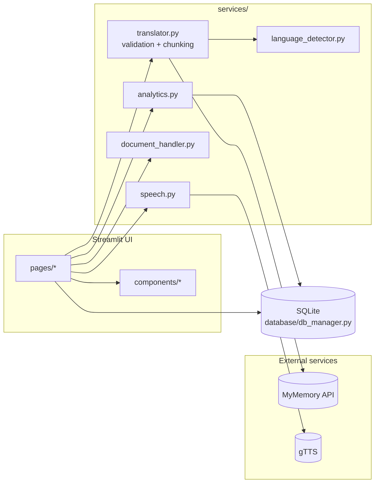
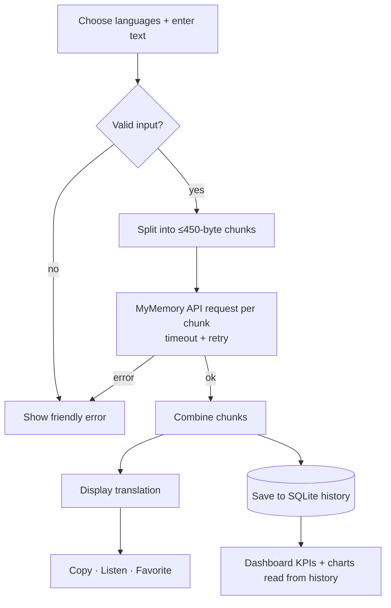

# 🌐 LinguaAI – Smart Language Translation Platform

A multilingual translation web app built with **Python + Streamlit**, using the **MyMemory Translation API**.
Translate text and documents, listen to the result, save favorites, and explore your usage on an interactive dashboard.

## Problem statement
People regularly need quick, reliable translations of short texts and documents. This project builds a practical tool that
takes text in one language, sends it to a real translation API, and returns the translation – with the surrounding features
(history, favorites, speech, analytics) that make it feel like a real product.

## Objectives
- Integrate a real translation API (no fake or hard-coded translations)
- Demonstrate Python, API handling, basic NLP (language detection, text chunking), data processing and visualization
- Keep the code modular, validated, tested and easy to extend

## Features
| Area | What it does |
|---|---|
| **Translator** | 19 languages, auto-detect, swap, character counter, copy, clear, loading spinner |
| **Documents** | TXT / PDF / DOCX upload, text extraction, chunked translation with progress bar, download |
| **Text-to-speech** | Listen to original and translated text (gTTS), graceful message for unsupported cases |
| **History** | SQLite-backed list with search, pagination, reuse, delete, clear-all |
| **Favorites** | Save / search / reuse / remove |
| **Dashboard** | KPI cards + 5 Plotly charts, all computed from stored history; empty states when there is no data |
| **Robustness** | Input & file validation, size limits, timeouts + one retry, friendly errors for quota / network / bad responses |

### Dashboard charts (all from real records)
1. Translation activity over time – line chart (daily / weekly / monthly)
2. Most used target languages – horizontal bar
3. Language distribution – donut
4. KPI cards – translations, characters, languages used, favorites
5. Source vs target languages – grouped bar
6. Usage by weekday – bar

Chart colours come from a colour-blind-safe palette that was validated for both light and dark themes.

## Technologies
Python 3.10+ · Streamlit · Requests · Pandas · Plotly · gTTS · SQLite · pypdf · python-docx · pytest

## System architecture


`TranslationService` talks to a `BaseProvider`; `MyMemoryProvider` is the current implementation. To add Google Cloud
Translation or Microsoft Translator, subclass `BaseProvider` and implement `translate_chunk` – the UI needs no changes.

## Application workflow


Document translation adds *upload → validate → extract text* in front of the same pipeline and a download step at the end.

## Database structure
```
translation_history(id PK, original_text, translated_text, source_language,
                    target_language, timestamp, character_count)
favorites(id PK, original_text, translated_text, source_language,
          target_language, created_at)
```
The file is created automatically at `data/linguaai.db` (git-ignored).

## Installation
```bash
git clone https://github.com/<your-username>/LinguaAI.git
cd LinguaAI
python -m venv .venv
source .venv/bin/activate        # Windows: .venv\Scripts\activate
pip install -r requirements.txt
```

## Run
```bash
streamlit run app.py
```
Open http://localhost:8501. Switch light/dark theme from **⋮ → Settings → Theme**.

Run the tests:
```bash
pytest -v
```

Optional configuration (see `.env.example`): `MYMEMORY_EMAIL` raises MyMemory's free daily quota; `LINGUAAI_DB_PATH` moves the database file.
No API key is required and no secrets are stored in the repository.

## Screenshots
Add your own after running the app (save into `docs/screenshots/`) and reference them here, e.g.:

```markdown


```

## API documentation
**MyMemory** – `GET https://api.mymemory.translated.net/get`

| Parameter | Meaning |
|---|---|
| `q` | text to translate (≤ 500 bytes per request – LinguaAI chunks at 450) |
| `langpair` | `source\|target`, e.g. `en\|hi` (`Autodetect\|hi` for auto-detection) |
| `de` | optional email, raises the free daily quota |

Response: JSON with `responseData.translatedText`, `responseStatus` (200 = OK) and `responseDetails`.
LinguaAI treats non-200 statuses and MyMemory's quota warning text as errors rather than showing them as translations.

Internal API (`services/translator.py`): `TranslationService.translate(text, source, target) -> TranslationResult`,
raising `ValidationError`, `APIError`, `APITimeoutError` or `QuotaExceededError`.

## Limitations
- MyMemory's free tier has a daily quota and its quality is lower than commercial engines, especially for long or technical text.
- Auto-detection is a lightweight offline heuristic (script analysis + stop-words); the API's own detection is the fallback.
- Scanned (image-only) PDFs are not supported (no OCR). Document limit: 5 MB / 20,000 characters.
- **SQLite is local.** On hosts with ephemeral storage (e.g. Streamlit Community Cloud) history is lost on restart; a hosted
  deployment would need a persistent database such as PostgreSQL. This project is intended to be run locally.
- Text-to-speech needs internet access (gTTS calls Google's service).

## Future enhancements
Google Cloud / Microsoft Translator providers · persistent cloud database · user accounts · OCR for scanned PDFs ·
translated DOCX/PDF export · translation memory & glossary · global search.

## Project structure
```
app.py                 entry point (navigation, styling)
pages/                 Home, Translator, Document Translation, History, Favorites, About
services/              translator, language_detector, speech, document_handler, analytics
database/              schema.py, db_manager.py
components/            sidebar, dashboard_cards, charts, translator_ui
assets/                logo.png, styles.css
tests/                 pytest suite
```
